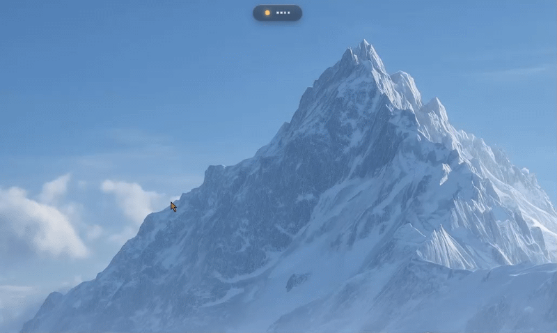

# 🏝️ Peek-a-boo: Apple-Style Dynamic Island & Floating Video HUD for Windows

> **Glance at your YouTube music videos while coding without Alt-Tabbing — zero double-audio, zero embed errors, pure zero-copy GPU streaming.**

[](https://www.microsoft.com/windows)
[](https://www.electronjs.org/)
[](LICENSE)
[](#how-it-works)
[](#architecture)

<p align="center">
  
</p>

---

## 🎯 Why Peek-a-boo?

When you're coding, compiling, or building projects with AI, you often have a YouTube music playlist running in the background. But whenever you want to glance at the music video:
* You have to `Alt+Tab` away from your IDE.
* Your workflow is interrupted.
* Mini-players or embedded widgets fail with **Error 150 / 152 / 153** on official music studio videos (Coke Studio, Sony, T-Series), play double audio, or buffer videos twice.

**Peek-a-boo solves this completely.** It rests quietly below your laptop webcam as a tiny frosted-glass pill. Whenever your AI agent or compiler takes time, **simply hover your mouse over the camera** — the notch smoothly unfolds with damped spring physics into the live video! Move your cursor away, and it instantly folds back.

---

## ✨ Features

* 🚫 **Zero Double-Audio**: Chrome plays the audio into your headphones. The desktop notch is strictly silent — **zero echo, zero desync**.
* ⚡ **Zero-Copy Direct Pixel Mirroring**: Frames are captured directly from the `<video>` element inside Chrome and decoded via `createImageBitmap()` + `ImageBitmapRenderingContext`. **Zero CPU pixel copying**.
* 🛡️ **100% Video Support (Zero Embed Blocks)**: Because it mirrors the already-decoded pixels from Chrome, **Error 150/152/153 is impossible**. Works on every video, VEVO track, live stream, and ad.
* 🍏 **Apple Spring Physics**: Damped harmonic oscillator animations using CSS `linear()` with 5.39% physical momentum overshoot.
* 🖱️ **Zero Click-Blocking**: When collapsed, the window enables `setIgnoreMouseEvents(true)`. **Clicks pass 100% straight through** into your IDE and desktop.
* 🧠 **Chromium Keep-Awake Probe**: Automatically prevents Chrome from freezing background video decoders using a 1x1 pixel offscreen canvas probe.
* 🎵 **YouTube Music Support**: Automatically falls back to high-res album covers with an Apple Music-style ambient backdrop blur when songs don't have video.
* 🔀 **Smart Multi-Tab Arbiter**: Automatically mirrors whichever YouTube tab you most recently hit play on.
* 🪟 **Windows System Tray**: Lives in the notification area near the clock with a procedural Retina-ready glowing dot icon and **"Start with Windows"** toggle.

---

## 🏗️ Architecture

```
┌────────────────────────────────────────────────────────┐
│                      GOOGLE CHROME                     │
│                                                        │
│   YouTube / YouTube Music Tab                          │
│   [ <video> Element ]                                  │
│            │                                           │
│            ▼ (Canvas Draw & Synchronous JPEG)          │
│   [ chrome-bridge/content.js ]                         │
│            │ (chrome.runtime.Port: "peek")             │
│            ▼                                           │
│   [ chrome-bridge/background.js ]                      │
└────────────┬───────────────────────────────────────────┘
             │ WebSocket (ws://127.0.0.1:48199)
             │ Bounded Flow Control (MAX_IN_FLIGHT = 2)
┌────────────▼───────────────────────────────────────────┐
│                   ELECTRON DESKTOP APP                 │
│                                                        │
│   [ desktop-app/bridge.js ] (WebSocket Server)         │
│            │                                           │
│            ▼                                           │
│   [ desktop-app/main.js ]                              │
│   - Transparent fixed-bounds window                    │
│   - OS-level cursor polling (every 30ms)               │
│   - setIgnoreMouseEvents (100% click pass-through)     │
│            │ (IPC ContextBridge)                       │
│            ▼                                           │
│   [ desktop-app/renderer.js ]                          │
│   - canvas.getContext('bitmaprenderer')                │
│   - Zero-copy GPU texture swap                         │
│   - CSS linear() spring animation                      │
└────────────────────────────────────────────────────────┘
```

---

## 🚀 Quick Start (Setup in 30 Seconds)

### Prerequisites
* **Windows 10 / 11**
* **Node.js** (v18 or higher recommended) & **npm**
* **Google Chrome** (or Chromium-based browser like Brave or Edge)

### 1. Clone the Repository
```bash
git clone https://github.com/Srimanikanta2006/Peek-A-Boo.git
cd peek-a-boo
```

### 2. Install Dependencies
```bash
cd desktop-app
npm install
cd ..
```

### 3. Load the Chrome Extension (One-time, takes 10 seconds)
1. In Chrome, open: `chrome://extensions/`
2. Turn on **Developer mode** (top right corner).
3. Click **Load unpacked** (top left).
4. Select the `chrome-bridge` folder inside this repository:
   ```text
   peek-a-boo/chrome-bridge
   ```
*(Existing YouTube tabs are automatically connected — no reload required!)*

### 4. Launch Peek-a-boo
Double-click:
* **`Start Peek-a-boo (Silent).vbs`** (Recommended: runs silently in the background with no terminal window).
* *Or* run `npm start` inside `desktop-app/`.

---

## 🎮 How to Use

1. **Play any video or playlist in Chrome** on [YouTube](https://youtube.com) or [YouTube Music](https://music.youtube.com).
2. Look right below your laptop webcam — your **glowing frosted pill** is active.
   * 🟢 **Mint Dot**: Video is playing.
   * 🟡 **Amber Dot**: Video is paused.
   * ⚪ **Grey Dot**: Waiting for YouTube.
3. **Hover your cursor over the notch**: It springs open into the live video!
4. **Move your cursor away**: It seamlessly folds back into the camera notch.
5. **Always in the Background**: Right-click the mint dot in your **Windows System Tray** (near the clock) to enable **"Start with Windows"** or quit.

---

## 🛠️ Tech Stack

* **Desktop Runtime**: [Electron.js](https://www.electronjs.org/) (Chromium + Node.js)
* **Real-Time Protocol**: [WebSockets (`ws`)](https://github.com/websockets/ws)
* **Browser Extension**: Chrome Extensions [Manifest V3](https://developer.chrome.com/docs/extensions/mv3/) (Service Worker + Content Scripts)
* **Graphics & Rendering**: HTML5 Canvas, `ImageBitmap`, `ImageBitmapRenderingContext` (`bitmaprenderer`)
* **Styling & Physics**: CSS3 Glassmorphism (`backdrop-filter`), CSS `linear()` Damped Harmonic Oscillator springs

---


## 📄 License

This project is licensed under the [MIT License](LICENSE).


